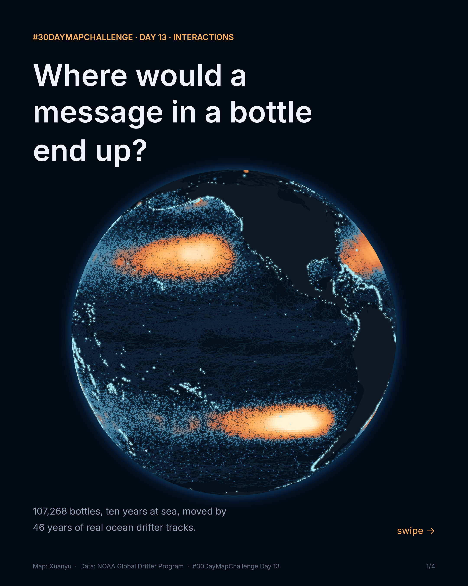
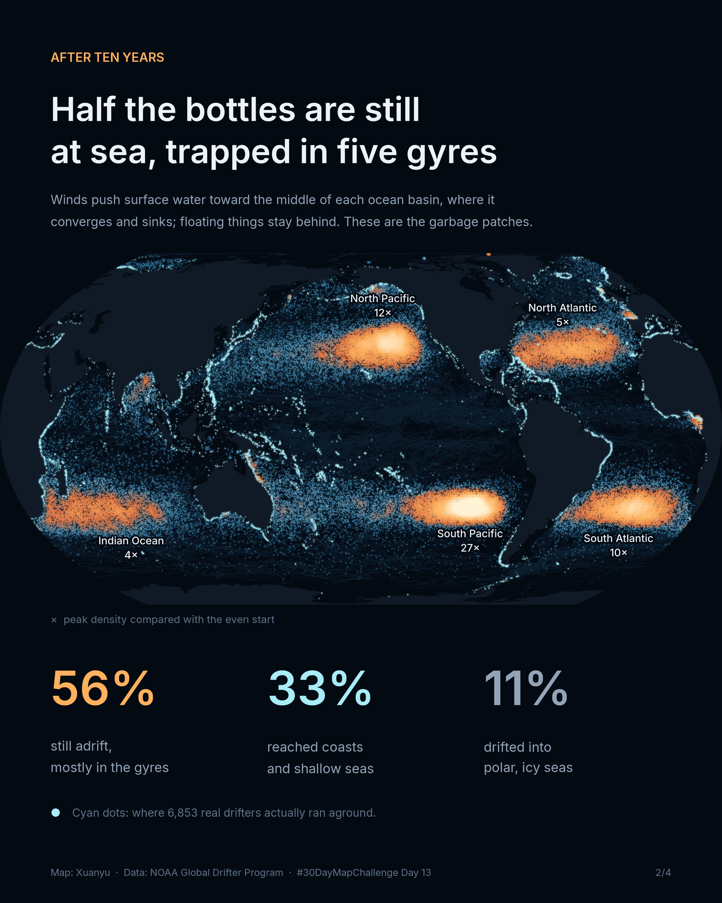
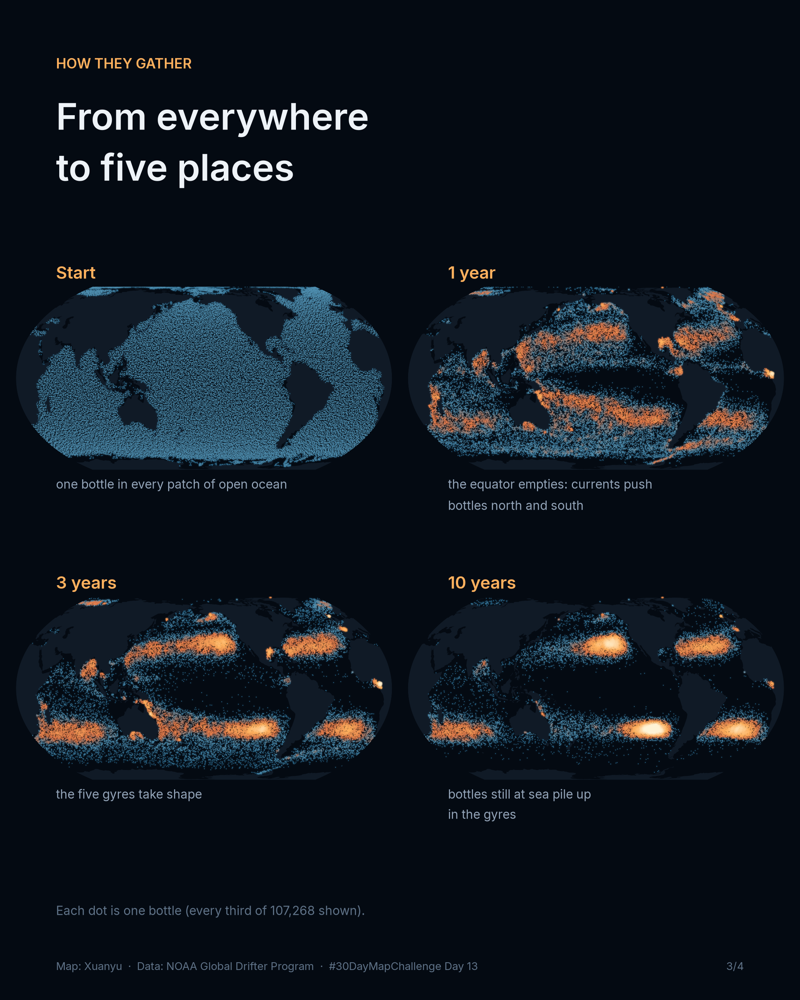
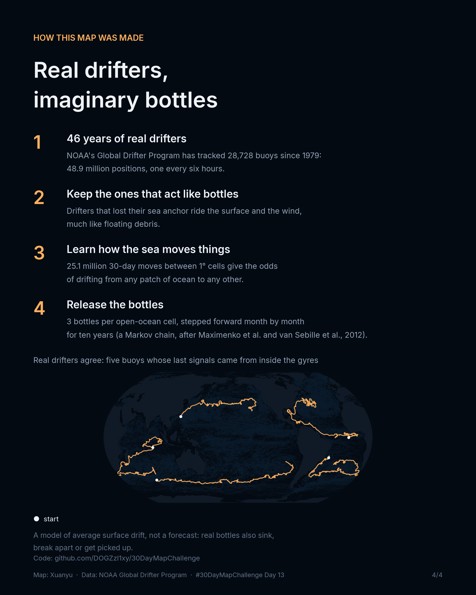
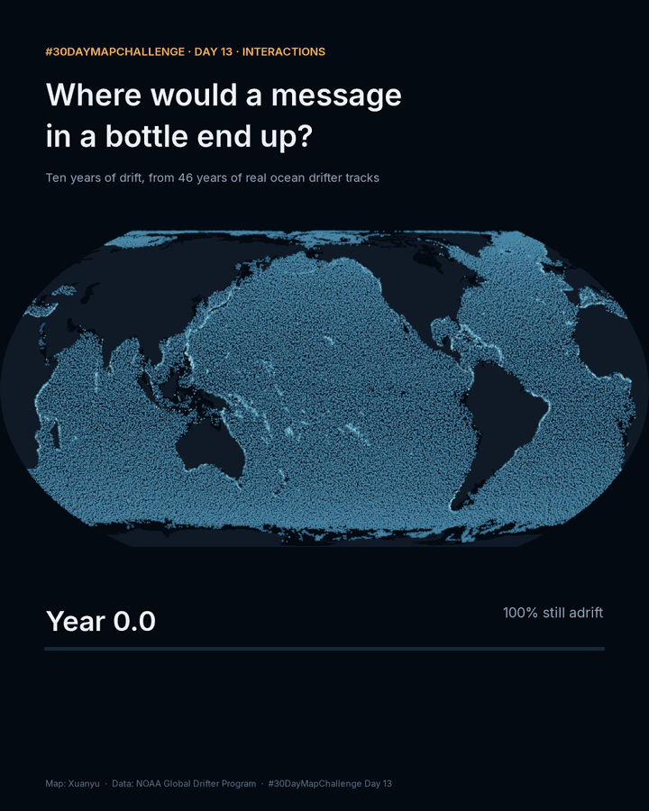

# Day 13 - Interactions

**Where would a message in a bottle end up?**

| | |
|---|---|
|  |  |
|  |  |



Wind and ocean currents interact to herd anything that floats into a handful of convergence
zones. This map lets 46 years of real drifter tracks decide where 107,268 imaginary bottles go
when released evenly over the open ocean. After ten years:

| Fate | Share |
|---|---:|
| still adrift at sea | 56% (50% inside the five gyre zones) |
| reached coasts and shallow seas | 33% |
| drifted into polar, icy seas | 11% |

Peak density relative to the even start: South Pacific 27×, North Pacific 12×,
South Atlantic 10×, North Atlantic 5×, Indian Ocean 4×. The North Pacific peak
(33.5°N, 147.5°W) lies between Hawaii and California, where the Great Pacific Garbage Patch is.

## Data

- Lumpkin, R. & Centurioni, L. (2019). *NOAA Global Drifter Program quality-controlled 6-hour
  interpolated data from ocean surface drifting buoys.* NOAA NCEI.
  [doi:10.25921/7ntx-z961](https://doi.org/10.25921/7ntx-z961). May 2025 release, read from the
  zarr store on [NOAA Open Data on AWS](https://noaa-oar-hourly-gdp-pds.s3.amazonaws.com/index.html)
  (`experimental/gdp6h_ragged_may25.zarr`): 28,728 drifters, 48.9 M positions, 1979-02 to 2025-06.
- Land polygons: [Natural Earth](https://www.naturalearthdata.com/) (via cartopy).

Only `lon`, `lat`, `time`, `drogue_status` and per-drifter metadata are downloaded (~600 MB,
cached in `data/day13_drifters/raw/`, git-ignored). The processed model
(`data/day13_drifters/bottles_model.npz`, ~3 MB) is committed so the slides can be redrawn
without the download.

## Method

1. **Bottle-like drifters.** Keep positions where the drifter had lost its drogue (sea anchor):
   undrogued drifters ride the surface and feel the wind, like floating debris.
2. **Transition matrix.** Pair each position with the same drifter's position exactly 30 days
   later (pairs spanning a data gap are dropped): 25.1 M pairs. Counting moves between 1° cells
   gives the probability of drifting from any cell to any other.
3. **Open ocean vs. sinks.** Cells with at least 10 observed departures are open ocean. The rest
   (coasts, shallow seas such as the Indonesian archipelago, sea ice) keep whatever drifts in,
   which is how bottles "wash up" in the model.
4. **Release and drift.** Three bottles per open-ocean cell (107,268) are stepped through the
   matrix month by month for 120 months (seed 13). The exact density is propagated alongside for
   the statistics. Method after Maximenko, Hafner & Niiler (2012) and van Sebille, England &
   Froyland (2012).
5. **Check against reality.** For each gyre, the real drifter that travelled furthest before its
   last signal near the modelled peak is drawn on the last slide.

**Caveats.** This is a model of average surface drift, not a forecast. Drifters are not bottles
(their windage differs), real debris also sinks, fragments or is picked up, and 1° cells blur the
coastline. Bottles reaching data-poor open-water cells are counted with "coasts and shallow
seas" (most such cells are marginal seas).

## References

- Maximenko, N., Hafner, J. & Niiler, P. (2012). Pathways of marine debris derived from
  trajectories of Lagrangian drifters. *Marine Pollution Bulletin*, 65(1–3), 51–62.
- van Sebille, E., England, M. H. & Froyland, G. (2012). Origin, dynamics and evolution of ocean
  garbage patches from observed surface drifters. *Environmental Research Letters*, 7(4), 044040.

## Reproduce

```bash
.venv/Scripts/python scripts/day13_drifters/make_map.py              # slides from the committed model
.venv/Scripts/python scripts/day13_drifters/make_map.py --rebuild    # download + recompute the model
.venv/Scripts/python scripts/day13_drifters/make_map.py --animate    # also render the MP4 + GIF (~minutes)
```

Outputs: `outputs/day13_drifters_0[1-4]_*.png` (2160×2700, 4:5 for Instagram/LinkedIn carousels),
`outputs/day13_drifters.mp4` (1080×1350, 24 fps) and `outputs/day13_drifters.gif` (720×900).
