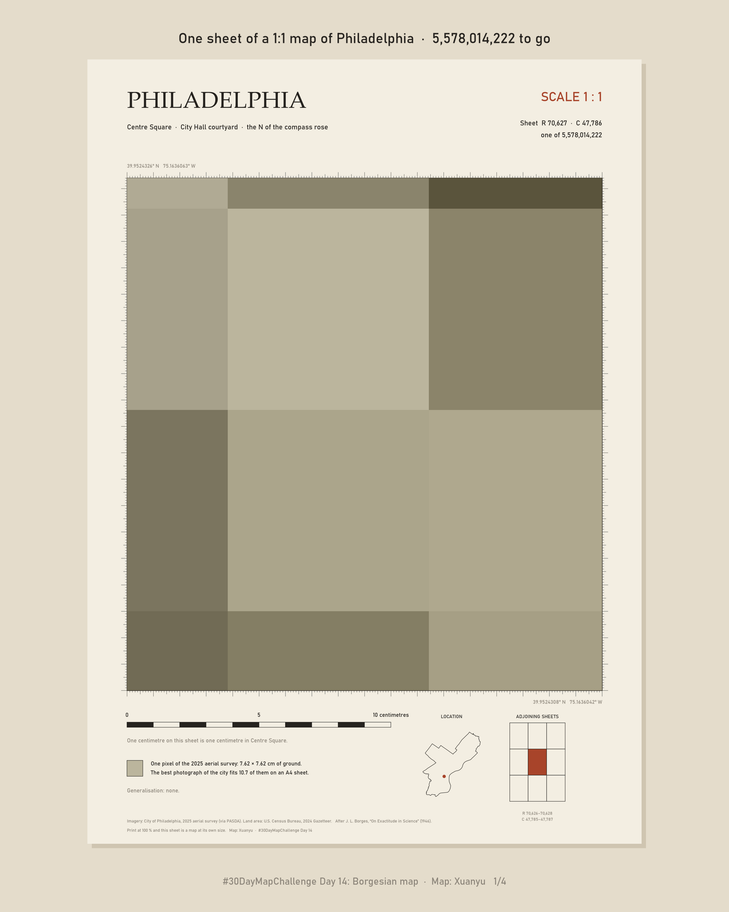
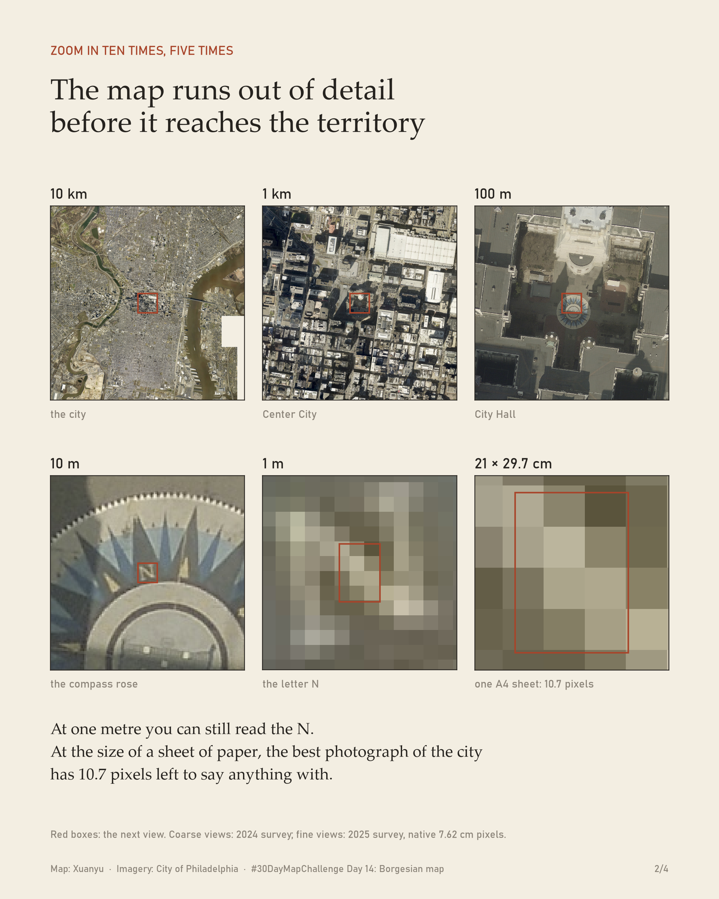
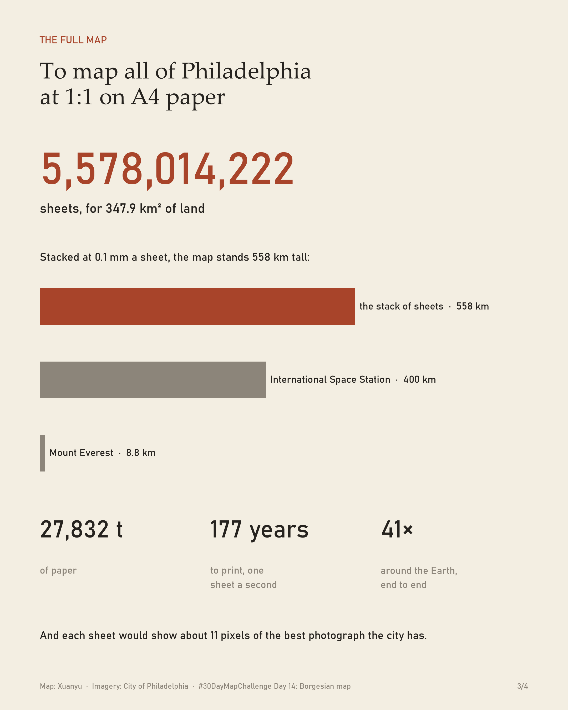
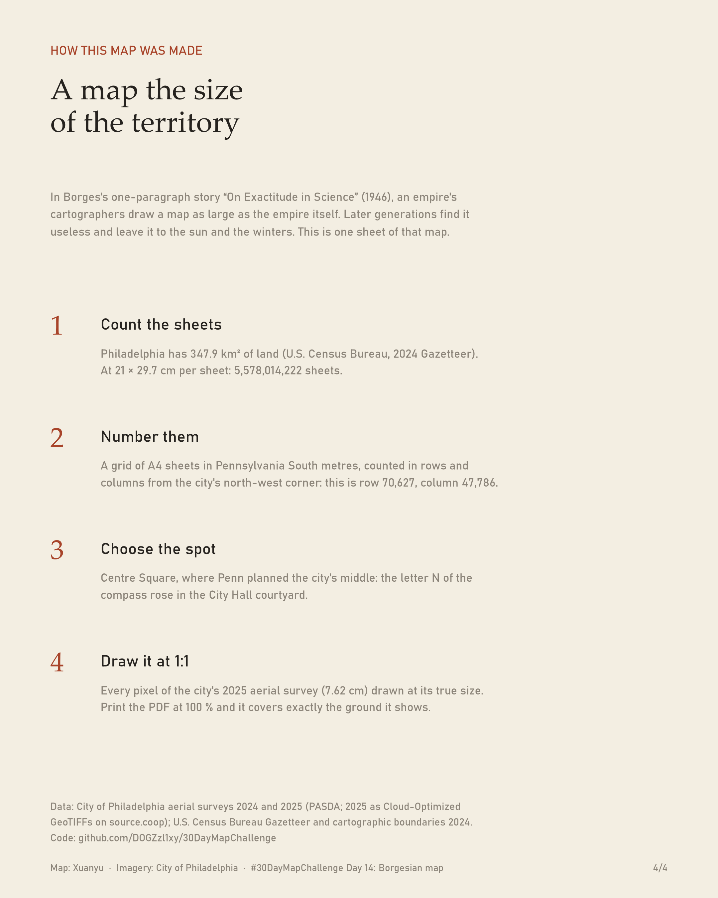

# Day 14 - Borgesian map

**Philadelphia at 1:1**

| | |
|---|---|
|  |  |
|  |  |

In Borges's one-paragraph story "On Exactitude in Science" (1946), an empire's cartographers
draw a map as large as the empire itself. This is one sheet of that map for Philadelphia: an A4
page at scale 1:1, centred on the letter N of the compass rose in the City Hall courtyard
(Centre Square). **Print [`outputs/day14_borgesian_a4.pdf`](../../outputs/day14_borgesian_a4.pdf)
at 100 % and it is a map at its own size.**

| | |
|---|---|
| Land area (2024 Census Gazetteer) | 347.9 km² |
| A4 sheets to cover it | 5,578,014,222 |
| This sheet | row 70,627, column 47,786 |
| Stack at 0.1 mm a sheet | 558 km (the ISS orbits at about 400 km) |
| Paper at 80 g/m² | 27,832 t |
| Printing at one sheet a second | 177 years |
| Laid end to end (long edge) | 41 × around the Earth |
| Pixels of the 2025 aerial survey per sheet | 10.7 (2.76 × 3.90) |

## Data

- **City of Philadelphia aerial imagery, 2025**, 3-inch (7.62 cm) ground sample distance,
  NAD83 / Pennsylvania South (ftUS, EPSG:2272), distributed by
  [PASDA](https://www.pasda.psu.edu/). Read as Cloud-Optimized GeoTIFFs from the
  [source.coop copy](https://source.coop/nlebovits/phl-aerial-imagery) (tile `26928E233974N`),
  so only the few pixels needed are downloaded, on their original grid.
- **City of Philadelphia aerial imagery, 2024**, via the
  [PASDA map service](https://services.pasda.psu.edu/server/rest/services/pasda/PhiladelphiaImagery2024/MapServer)
  `export` endpoint, for the 10 km and 1 km views (server-side mosaics).
- **U.S. Census Bureau 2024 Gazetteer** (places): `ALAND` of Philadelphia city (GEOID 4260000).
- **U.S. Census Bureau 2024 cartographic boundary file** (places, 1:500k): city outline for the
  sheet grid and the location diagram.

Downloads are cached in `data/day14_borgesian/raw/` (git-ignored).

## Method

1. **Count the sheets.** Land area / (0.210 m × 0.297 m).
2. **Number them.** A grid of portrait A4 sheets in NAD83 / Pennsylvania South (metres,
   EPSG:32129), counted in rows and columns from the north-west corner of the city's bounding box.
3. **Choose the spot.** Centre Square, the middle of Penn's plan: the letter N of the compass
   rose in the City Hall courtyard (EPSG:2272 x = 2,693,508.92 ft, y = 236,146.72 ft).
4. **Draw at 1:1.** The page is built in millimetres; the map area (18.0 × 19.4 cm) shows the
   ground around the spot, with every 2025 pixel drawn as a 76.2 mm square at its true position.
   The PDF keeps the pixels as vector squares, so the scale holds at any print resolution.
5. **Zoom.** Views 10 km → 1 km → 100 m → 10 m → 1 m → one sheet, each ten times closer.

**Caveats.** "Print at 100 %" assumes the printer does not scale to fit. The sheet grid is a
convenient construction, not an official one; the sheet count uses land area, so partial sheets
along the shore and city limits are counted fractionally.

## Reproduce

```bash
.venv/Scripts/python scripts/day14_borgesian/make_map.py
```

Outputs: `outputs/day14_borgesian_a4.pdf` (print at 100 %), `outputs/day14_borgesian_a4.png`
(300 dpi), and the 4:5 carousel `outputs/day14_borgesian_0[1-4]_*.png` (2160 × 2700).
